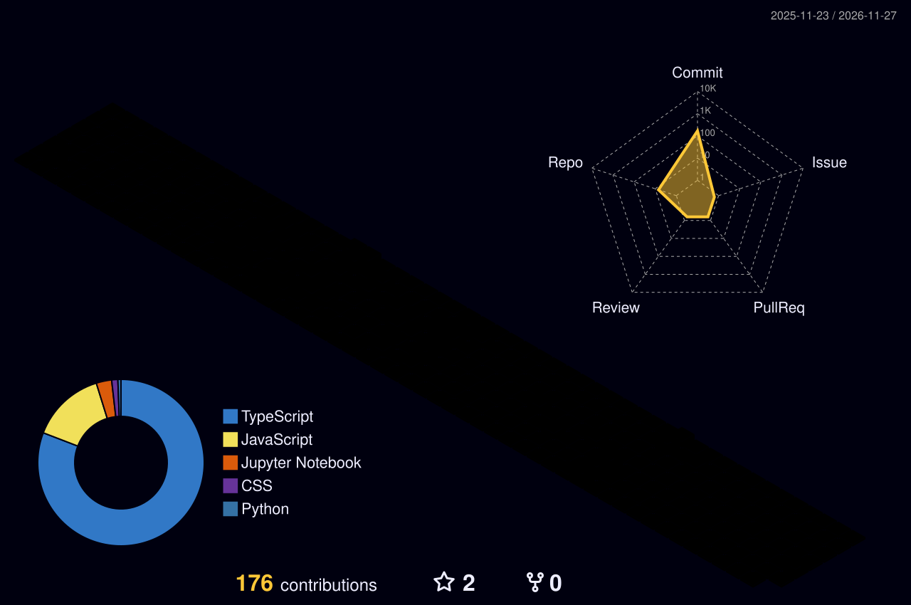

###  Nice ways to reach me

----

Hi! I'm Lucas Kim, a Software Engineer passionate about AI Engineering, Machine Learning, and building intelligent applications that solve real-world problems!

----
### Personal stats:

  
Highlights / Proficiencies

   

  <strong>Highlights</strong>

  - ⭐ 1st Place — Code Network 2025 Winter Hackathon.
  - ⭐ Executive Dean's Commendation — Queensland University of Technology (QUT).
  - ⭐ Developed Me Squared AI, a conversational AI application integrating STT, LLMs, TTS, voice cloning, and speech pattern analysis.
  - ⭐ Developed business applications and automated workflows using Microsoft Power Platform, including Power Apps, Power Automate, Power Pages, and Dataverse.
  - ⭐ Microsoft Certified: Azure Data & AI Fundamentals.

   

  <strong>Proficiencies</strong>

  - 🧠 AI Engineering: LLMs, Agentic AI, AI Automation, RAG, MCP
  - 📊 Machine Learning: Deep Learning, PyTorch, Scikit-learn, Computer Vision
  - 📚 Languages: Python, JavaScript, TypeScript, Java
  - 🌐 Full-stack Development: React, Node.js, FastAPI, REST APIs
  - ⚡ Microsoft Power Platform: Power Apps, Power Automate, Power Pages, Dataverse
  - ☁️ Cloud & DevOps: Azure, Docker, CI/CD
  - 🗄️ Databases: SQL, PostgreSQL, DynamoDB, Supabase
  - 🔧 Collaboration & Tools: Git, GitHub, Notion, Agile

### 💻 Skills

  
Tech Stack

#### 🧠 AI & Machine Learning

#### 💻 Programming Languages

#### 🌐 Web & App Development

#### ☁️ Cloud & DevOps

#### 🗄️ Databases & Query Languages

#### ⚡ Microsoft Power Platform

#### 🛠️ Development & Collaboration Tools

----

